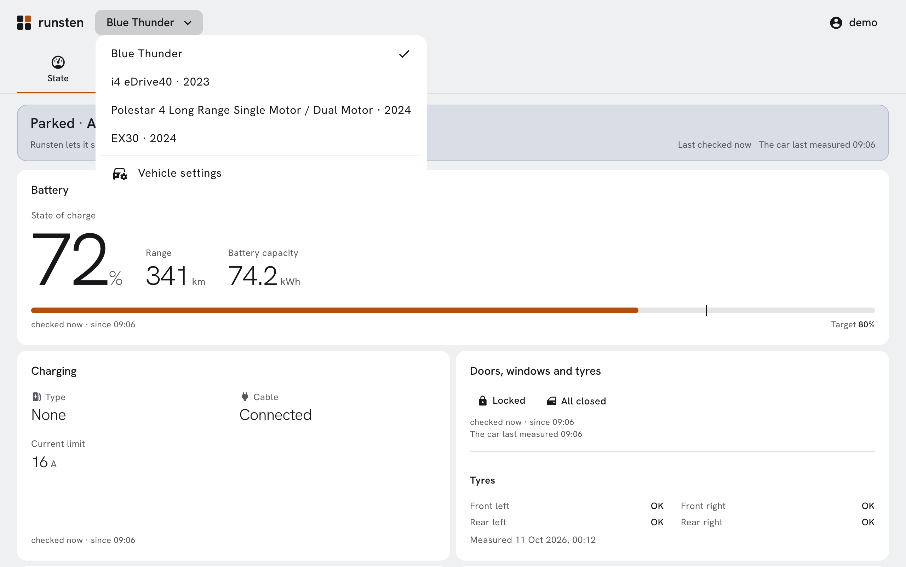

# Runsten

[](https://github.com/runsten-app/runsten/actions/workflows/ci.yml)
[](https://github.com/runsten-app/runsten/releases)
[](LICENSE)

> Open source data logger for electric cars: Volvo, Polestar, Tesla, BMW and Mini, with more makes to come.

**[runsten.app](https://runsten.app)** · [Documentation](https://runsten.app/docs/) · [Self-hosting](https://runsten.app/docs/self-hosting/)

<picture>
  <source media="(prefers-color-scheme: dark)" srcset=".github/readme/vehicles-dark.png">
  
</picture>

Runsten records the trips, charges and costs of your electric cars, and shows them as a history and as statistics. It reads each car from its manufacturer, on a server of your own:

- **Volvo**, through the Volvo Cars API;
- **Polestar**, through Polestar's Data Portal (or, outside the EU and the EEA, the Polestar app's API, in beta);
- **Tesla**, through the Owner API of the Tesla app;
- **BMW and Mini**, through BMW CarData.

Other makes will follow. One account follows several vehicles, of one make or of several: a Volvo and a Tesla in the same garage are each read from their own manufacturer, and switched between from the bar of every page.

The name comes from runestones (*runsten* in Swedish), which often commemorated journeys: Runsten carves your car's trips in stone.

- **A collector** polls each manufacturer's API and keeps every response as it came; trips and charges are worked out from them, including those that happened while nothing could be read, marked as reconstructed.
- **A web interface**, on a phone as well as a desktop, in English, French, German, Italian, Dutch, Norwegian, Spanish and Swedish: the car's state, its trips and charges, their costs from your tariffs, statistics, and an estimate of the battery's capacity.
- **An API** (`/api/v1`) and **MQTT** publishing, with Home Assistant's discovery, for your own scripts and home automation.

Status: **early development**. Expect changes between versions.

## Self-hosting

Runsten runs with Docker Compose on any Linux server: a NAS, a small VPS, a Raspberry Pi 4 or 5. To read a Volvo, it needs an application of your own on the [Volvo Cars developer portal](https://developer.volvocars.com/); a Polestar or a Tesla needs none, and a BMW or a Mini only a client ID you create in BMW's portal.
The [documentation](https://runsten.app/docs/) covers [installing](https://runsten.app/docs/self-hosting/), [connecting a Volvo](https://runsten.app/docs/self-hosting/volvo), [a Polestar](https://runsten.app/docs/guide/polestar) or [a Tesla](https://runsten.app/docs/guide/tesla), [a BMW or a Mini](https://runsten.app/docs/guide/bmw), [updating](https://runsten.app/docs/self-hosting/updating), [backups](https://runsten.app/docs/self-hosting/backup) and [the API](https://runsten.app/docs/reference/api); its sources are in [`documentation/`](documentation/).

## Development

A simulator plays the API of every supported make (Volvo, Polestar, Tesla, BMW), so that you can work without a car. [`DEVELOPMENT.md`](DEVELOPMENT.md) explains how to set Runsten up, run and test it, and how releases are made; [`ARCHITECTURE.md`](ARCHITECTURE.md) how the code is organized; [`CONTRIBUTING.md`](CONTRIBUTING.md) how to propose a change. In short:

```sh
task web-install     # once: the front end's dependencies (Node of web/.nvmrc)
tilt up              # the whole stack on the simulator: http://127.0.0.1:5173 (admin / runsten-dev-password)
task unit            # format, lint, tests and build, before a pull request
```

## Licence

[AGPL-3.0-or-later](LICENSE).

---

Runsten is an independent project, not affiliated with Volvo Car Corporation, Polestar, Tesla or the BMW Group. "Volvo", "Polestar", "Tesla", "BMW" and "MINI" are trademarks of their respective owners.
